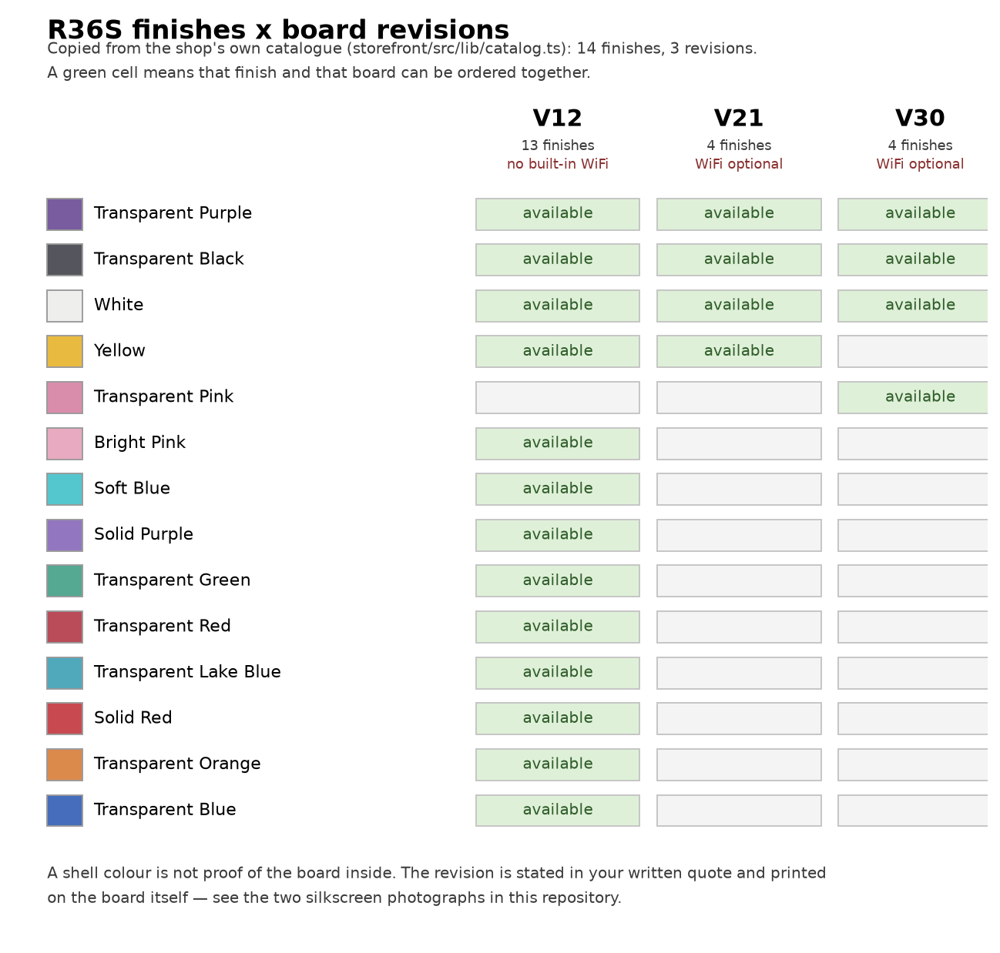
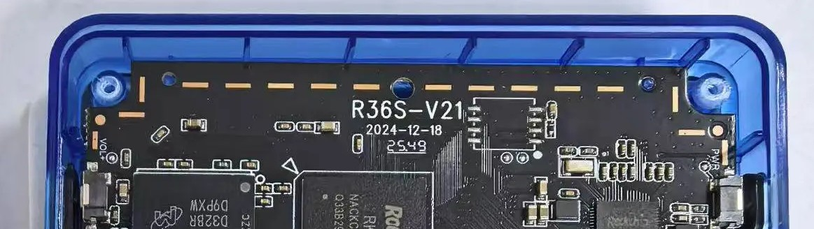
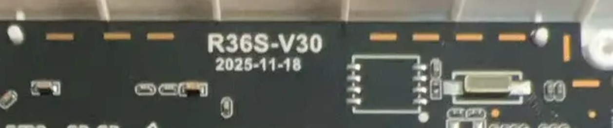
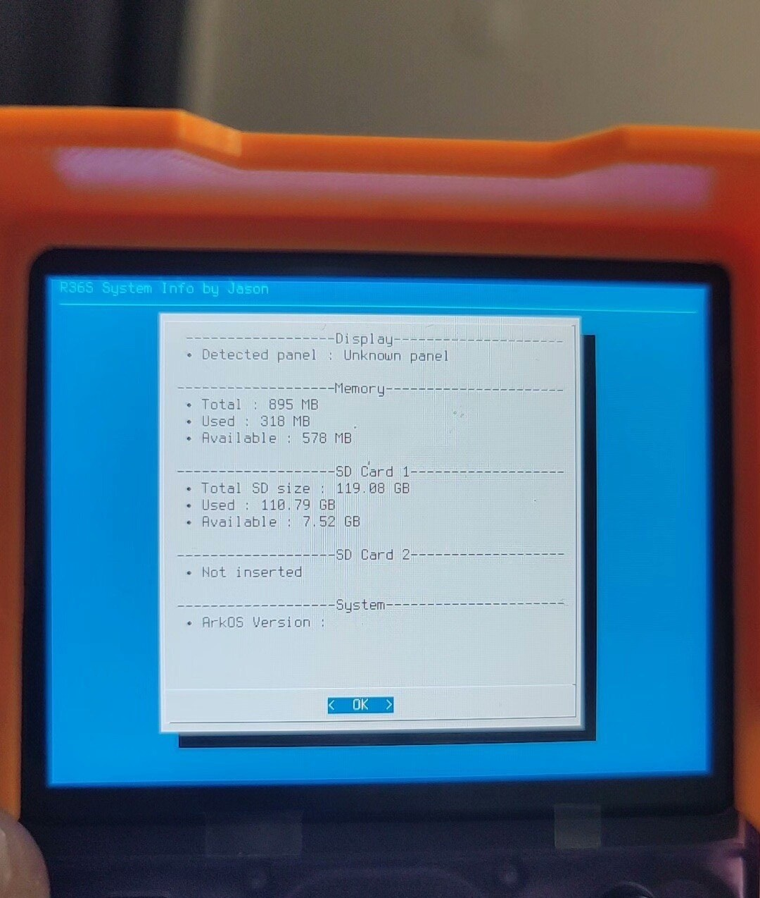
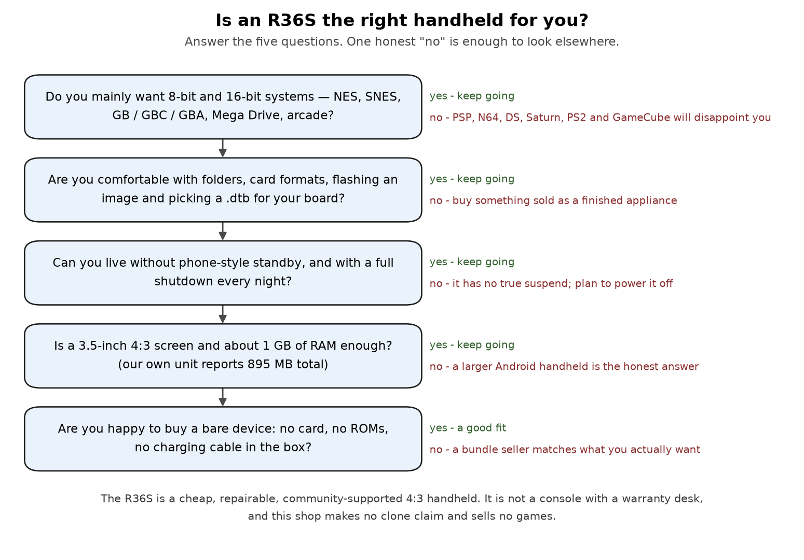

# R36S V12 / V21 / V30 怎么选 —— 版本差在哪、配色怎么对应、以及**谁不该买**

**[English](README.md)** · **中文**

> **一句话结论。** V12、V21、V30 是**同一台机器的不同供应商主板版本**，不是性能分档——同一个 RK3326 平台、同一个外壳、同一套按键。真正有区别的是**能选哪些配色**和**有没有内置 WiFi 这个选项**：
>
> | 版本 | 配色 | 内置 WiFi |
> |---|---|---|
> | **V12** | 13 种配色 | 不提供，用 USB 网卡方案 |
> | **V21** | 4 种：透明紫、透明黑、白色、黄色 | 可选 |
> | **V30** | 4 种：透明紫、透明黑、白色、透明粉 | 可选 |
>
> **外壳颜色不能证明里面是哪块板**，商品页写着"V12"也不能。版本印在主板上：我们的样品板丝印是 `R36S-V21 2024-12-18` 和 `R36S-V30 2025-11-18`。
>
> **谁不该买：** 想流畅玩 PSP / N64 / NDS / 土星 / PS2 / GameCube 的人、期待手机那种待机的人、不能接受掉存档的人、要求包装里带游戏和内存卡的人、以及需要"官方认证非克隆"的人。这份清单比你在别处看到的宣传文案长得多——而这正是本文的意义：[直接跳到那一节](#谁不该买-r36s)。

---

## 买家真正在问什么

以下是从 **22,869 条去重后的 QQ 群消息**只读导出里逐字复制出来的原文。只标群名，不标发言人——导出数据无法可靠归属到个人。

| 群 | 原文（逐字，未改写） |
|---|---|
| 安伯尼克掌机交流群 | `请问现在477v掌机8+128，二手，1250块钱值不值` |
| 玩机社5群 | `请问一下，有没有500以下的开源掌机推荐啊，` |
| 玩机社5群 | `500元性价比最高的主机或掌机有什么🤔` |
| 开源掌机中文社区⑤群 | `500块钱预算买一个竖版掌机，有推荐的吗` |
| r36s（开源掌机）交流1群 | `群友们，这r36s有踩坑吗` |
| r36s（开源掌机）交流1群 | `我前几天刚买的R36MAX2，第一次接触掌机，不知道买的好不好，想找个群了解了解，问问性价比怎么样，还有好多不明白` |
| r36s（开源掌机）交流1群 | `以前也是看的R36S这款，今年再看的时候，看到了这款R36max2，屏幕大一点了，贵了100，就买了现在这个` |

**关于这批数据的局限。** 拿不到时间范围、每条消息无法归属到"哪一天"、无法归属发言人，另外至少还有 3 个相关群只抓到了群名和群公告、没抓到消息正文。以上引文按导出原样引用，未做任何改写。

### 口碑确实是两极的

我们自己就在卖这台机器，所以负面的一并贴出来。

| | 原文（逐字） | 群 |
|---|---|---|
| 正面 | `听我的，寨机就买个r36s足够了` | r36s（开源掌机）交流1群 |
| 正面 | `gba的话，r36s就够了` | r36s（开源掌机）交流1群 |
| 负面 | `r36s现在一堆推广` | r36s（开源掌机）交流1群 |
| 负面 | `B站里面全是R36S的玩机技巧，这款的全是广告宣传` | r36s（开源掌机）交流1群 |
| 负面 | `r36s感觉太多了 怕翻车` | r36s（开源掌机）交流1群 |
| 负面 | `r36s掉存档了` —— 两条独立消息 | 开源掌机中文社区⑤群 |
| 负面 | `不过果然r36s正版v12接上wifi后就有噪音了` | R36S掌机爱好者 |

两边都是真的。它是一台便宜、可修、资料多的 4:3 掌机——**同时**也是一台被大量推广内容包围、有掉存档反映、WiFi 版有底噪的机器。下面每一条都会正面处理，包括我们解释不了的那些。

---

## 版本混乱是怎么来的

三个原因，没有一个是买家的错。

1. **版本号来自主板，不来自商家，也不来自什么市场规划。** 它们是供应商的主板版本号，直接丝印在 PCB 上，旁边还有日期：我们自己的样品板是 `R36S-V21` / `2024-12-18` 和 `R36S-V30` / `2025-11-18`。
2. **卖家列的是颜色，买家把颜色读成了版本——这是错的。** 同一个配色可能建在不止一块板上：透明紫、透明黑、白色在三个版本上都有。所以"我买的是紫色那台"完全不能说明里面是哪块板。
3. **版本真正要紧的地方只有一个：固件和 `.dtb`。** 社区固件镜像里带多个设备树，选错对应自己主板的那一个，就是最容易翻车的一步。版本号在社区里被反复提，**绝大多数时候是"软件配对"问题，不是硬件质量分档**。

---

## 到底差在哪

### 配色 × 版本对照表（直接来自我们自己的商品目录）

*这张图由店铺自己的目录数据（`storefront/src/lib/catalog.ts`）直接生成：14 种配色 × 3 个版本，以及哪些组合可以下单。不是渲染图，也不是猜的。*

| | V12 | V21 | V30 |
|---|---|---|---|
| **配色数量** | 13 | 4 | 4 |
| **透明紫** | 有 | 有 | 有 |
| **透明黑** | 有 | 有 | 有 |
| **白色** | 有 | 有 | 有 |
| **黄色** | 有 | 有 | — |
| **透明粉** | — | — | 有 |
| **亮粉** | 有 | — | — |
| **浅蓝** | 有 | — | — |
| **实色紫** | 有 | — | — |
| **透明绿** | 有 | — | — |
| **透明红** | 有 | — | — |
| **透明湖蓝** | 有 | — | — |
| **实色红** | 有 | — | — |
| **透明橙** | 有 | — | — |
| **透明蓝** | 有 | — | — |
| **内置 WiFi** | 不提供 | 可选 | 可选 |
| **USB 网卡 + 转接头** | 有 | 有 | 有 |

**想要少见的配色，就选 V12。** V12 至今留在产品线里，唯一的原因就是它：13 种配色，对应新板的 4 种。

**想要内置 WiFi，就选 V21 或 V30。** 但在你决定"要 WiFi"之前，请先看清披露：

- WiFi 版有**轻微喇叭底噪**。站上产品页在购买前就写明了这一点，而上面引的那条群消息就是有人在自家机器上发现了同一件事。
- **关掉 USB 或网络相关设置之后，可能需要重刷系统才能把 WiFi 恢复回来。** 这不是吓唬人，而是一个恢复能力上的限制——我们宁愿提前告诉你，也不想让你自己撞上。
- 任何版本（包括 V12）都可以加 **USB 网卡 + 转接头**，正好绕开上面两条。

> ⚠️ 未解决：那条群消息说的是 **V12** 接上 WiFi 后有噪音。但在我们自己的目录里，V12 **根本不提供内置 WiFi**——所以那台机器要么是用了外置网卡，要么来自我们没在做的批次。我们不打算把它"解释掉"，我们只是不知道。

### 哪些东西**没有**区别

这一点比版本表更重要，因为这才是大家真正想知道的：

- **同一个 SoC。** 我们照片里的板子上都是 **Rockchip RK3326**，V21 样品和 V30 样品都一样。
- **同一档内存。** 我们自己拍的真机系统信息页显示 **`Total: 895 MB`**——也就是标称 1 GB 的机器减掉系统占用之后的实际值。
- **同一套形态。** 竖版 3.5 英寸 4:3 屏、十字键、四个动作键、**双摇杆**、四个肩键、两个卡槽。
- **没有任何一个版本是性能升级。** 如果哪个商品页暗示 V30"更快"，那不是你能买到手的差别。版本之间的区别只在配色范围、供货和 WiFi 选项。

*我们自己货源的一块 V21 样品主板：丝印 `R36S-V21`、`2024-12-18`。供应商样品实拍，未做修饰。*

*我们自己货源的一块 V30 样品主板：丝印 `R36S-V30`、`2025-11-18`。同一套布局家族，同样的 SoC 丝印。供应商样品实拍，未做修饰。*

*真机上的供应商系统信息页（标题为 `R36S System Info by Jason`）：`Total: 895 MB`、`Used: 318 MB`，以及一张 119.88 GB 的卡，已用 110.79 GB、剩余 7.52 GB。这是一张屏幕实拍，不是规格书——而它是本文里最有用的一个数字，因为它告诉你机器**实际上**是什么样，而不是商品页宣称什么样。*

---

## 怎么选

1. **先按"我绝对不能没有什么"定版本。** 要内置 WiFi → V21 / V30；要某个少见的颜色 → V12；两样都无所谓 → 就按配色和价格选，因为平台是同一个。
2. **决定你到底要不要 WiFi。** 它带来轻微底噪和一个恢复限制。如果你只是想玩游戏，不要 WiFi 就少了一整类麻烦。
3. **选一个一年后你还会喜欢的配色。** 透明壳会显灰；实色壳藏住了让这台机器好玩的那部分内部结构。这是审美，不是性能。
4. **在付钱之前想清楚游戏从哪来。** 裸机不带游戏、不带卡、不带充电线。如果你的要求是"开箱就有游戏能玩"，那裸机就是错误的购买对象——这家店也是。
5. **把配置写进订单。** 主板版本、配色、要不要 WiFi、要不要网卡——付款前写清楚。"左边那个"和"V30 那种"都不是订单规格。

---

## 到手后怎么核对

1. **看主板。** 拆开后盖，丝印给出的是版本和日期：`R36S-V12`、`R36S-V21`、`R36S-V30`，后面跟一个日期码。这是我们唯一当作结论的方法，也是我们公开主板照片的原因。
2. **核对 WiFi 选项。** 如果下单时约定了内置 WiFi，确认收到的机器上确实有。按我们自己的目录，内置 WiFi 是 V21 / V30 的选项。
3. **看系统信息页。** 我们的机器上有一个标题为 `R36S System Info by Jason` 的供应商页面，含 `Display`、`Memory`、`SD Card 1/2`、`System` 几个区块。有用——但请注意下面的提醒。
4. **不要相信颜色。** 紫、黑、白三个版本都有。
5. **拆之前先拍照**，把包装留好。后面任何沟通都会变得很简单。

> ⚠️ 未实测 / 软件路线上的诚实限制：正在运行的系统报告的是**它启动时用的那个设备树**，不一定是你脚下那块主板。如果上一任主人把 V21 的 `.dtb` 刷进了 V30 的板子，任何软件检查都会愉快地报 V21。所以我们**不**把"敲这条命令就知道版本"当作已验证的方法发布——我们背书的只有看丝印。
>
> ⚠️ 同样未经我们验证：那张系统信息照片来自我们自己货源的一台机器，而该界面上 `ArkOS Version:` 那一行在这台机器上是空的。我们不会去填一个自己没读到的版本号。

---

## 谁不该买 R36S

这一节会让我们少赚钱。它也是绝大多数买家唯一真正需要的一节。

**想流畅玩 PSP、N64、NDS、土星、PS2、Dreamcast 或 GameCube 的人，不要买。** RK3326 是四核 Cortex-A35 级别的芯片，Mali-G31 级别的 GPU，内存约 1 GB。这台机器就是为了 8 位和 16 位机存在的；PS1 在这个芯片档位上通常跑得不错；再往上就是要你在第一个小时里就会察觉的妥协。我们**不发布任何帧率测试数据**——请把这句话当成我们划的一条边界，而不是我们做过的测量。社区自己的说法也一样：

- `专用的可以特别优化，R36那种充其量只是整合的一堆模拟器`（r36s（开源掌机）交流1群）
- `我这个为啥psp模拟器没有呢`（r36s（开源掌机）交流1群）
- `你猜猜为什么土星模拟器不行`（安伯尼克掌机交流群）

**想要"像手机一样"的设备的人，不要买。** `开源是没待机`——没有真正的待机。你要么关机，要么第二天发现它是空的。

**丢一次存档就会毁掉你一周心情的人，不要买。** `r36s掉存档了` 在同一个群里出现了两次，其中一条后面紧跟着 `正常` 两个字——说得好像这是件稀松平常的事。这是社区自己的说法，不是我们的。我们**没有经过验证的根本原因**可以给你。

> ⚠️ 未实测：我们没有复现过掉存档，所以给不出原因。能给的是能降低风险的做法：游戏内正常存档**并且**用即时存档（save state）、退出游戏走模拟器自己的退出流程而不是直接关机、系统运行时绝不拔卡、并且把存档在电脑上留一份备份。以上都不构成保证。

**要求包装里带内存卡、充电线或游戏的人，不要买。** 我们的商品就是按裸机卖的：不带卡、不带 ROM 库、不带充电线。我们不卖任何有版权的 ROM，任何合规的渠道也一样。

**需要一纸证明来回答"这是不是正版非克隆"的人，不要买。** 我们的立场写在站上产品页：主板照片只展示**那些样品上**可见的东西，**一张样品照片不能为每个出货批次背书，我们也不做非克隆的断言。** 如果有卖家告诉你一张照片就证明了正品，那是在过度包装。

**把"最低价"当作唯一标准的人，不要买。** 国内市场上带卡版本见过约 ¥260（`拼多多那时候买的游戏机，带内存卡也才260多`，R36S掌机爱好者），二手机更便宜，而我们自己在 2026 年 10 月的市场调研里记录到的最低美国挂牌价是 **$52**——低于我们的起售价，不过我们**没有**核实那个挂牌里到底包含什么。如果价格就是全部决策依据，那请去买那些：这是一个合理的选择，这家店不是这个问题的答案。像我们这样的店，收费换来的是写进订单的明确配置、如实披露的取舍、不带 ROM 的裸机，以及 7 天无理由退货和直接支持。如果这些对你一文不值，那就是一文不值。

**想要 OLED 屏、HDMI 输出、更大的屏幕或者现代 3D 游戏的人，不要买。** 这些都不是这台机器。关于它上面那一档市场，群里自己有一句话（安伯尼克掌机交流群）：`其他掌机都比去年更贵`——如果你要的是那个，那就该买那个。

---

## 价格：数字到底是什么

| 数字 | 是什么 | 出处 |
|---|---|---|
| **$69** | 本店**裸机 V12** 的起售价 | 我们自己公布的裸机 V12 起售价 |
| 书面报价的到手总价 | 主板、配件、带跟踪的运费，以及进口税费责任 | 我们的订单条款——$69 不是到手价 |
| $79.99 | 美国公开电商平台上**带 128 GB 卡和游戏**的 R36S 挂牌 | 我们 2026 年 10 月的市场调研记录 |
| $52.00 | 我们记录到的最低 R36S 挂牌，透明紫，未注明是否含卡 | 同一份调研——⚠️ 我们**没有**核实该挂牌的实际内容 |
| 约 ¥260 | 国内电商带卡版本 | QQ 群消息（R36S掌机爱好者）——⚠️ 社区反映，未经验证 |
| 1250 元 | 二手 8+128 的安卓掌机，属于**另一个更高档位**的机器 | QQ 群消息（安伯尼克掌机交流群）——之所以列在这里，是因为"值不值"这个问题通常问的是那一档，而不是 R36S |

**把这张表诚实地读一遍，结论是：$69 的裸机 R36S 并不自动等于最便宜的 R36S。** 我们在同一个市场里记录到一个 $52 的挂牌和一个 $79.99 带卡带游戏的套装，国内价格还要低得多。你真正在选的是：一台配置写清、取舍如实披露的裸机，还是一个卡、卡的质量和 ROM 内容都不是你选的套装。两者都是正当的购买。不要让任何一家店——包括我们——告诉你后一种不存在。

---

## 怎么才能不踩坑

付款前，把这五个问题问清楚，并且要书面答复。答案很便宜，事后才发现很贵。

1. **到底是哪个主板版本？** V12、V21 还是 V30，写进订单记录。
2. **有没有内置 WiFi？** 如果有：底噪有没有提前披露？有没有告诉你网络设置可能需要重刷才能恢复？
3. **交付里包含什么，到手总价多少？** 商品、运费、进口税费谁承担。
4. **退货窗口多长，退货运费谁付？**
5. **出问题找谁？** 一个明确的渠道，而不是"联系我们"。

然后用同样苛刻的眼光去看任何评测——因为前面引过的那句话：`B站里面全是R36S的玩机技巧，这款的全是广告宣传`。有用的视频会测点东西（续航、温度、帧率）、会讲缺点、或者会拆机。只开箱、只说"性价比真高"的视频就是广告，不管它有没有标注"广告"。这个批评是公允的，而且在这个产品上比在多数产品上更成立；正确的回应不是跟它争，而是成为那个例外。

---

## 哪些是实测的，哪些不是

| 说法 | 依据 |
|---|---|
| V12 是 13 种配色；V21 和 V30 各 4 种；具体是哪 4 种 | **我们自己的目录数据**，已作为图和表发布在本仓库里 |
| 内置 WiFi 是 V21/V30 的选项；网卡方案三个版本都能加 | **我们自己的目录数据** |
| V21 与 V30 的丝印，日期分别为 `2024-12-18` 和 `2025-11-18` | **我们自己的主板实拍照片** |
| 两块板上都是 Rockchip RK3326 | **我们自己的主板实拍照片** |
| 真机系统信息显示总内存 895 MB | **我们自己的照片**（供应商系统信息页） |
| 裸机 V12 起售价 $69 | **我们自己公布的价格**；到手总价以书面报价为准 |
| $79.99 带卡套装、$52 最低挂牌 | **我们自己的市场调研记录**，2026 年 10 月。⚠️ $52 那条的实际内容未核实 |
| 国内带卡约 ¥260 | QQ 群消息（R36S掌机爱好者）。⚠️ **社区反映，我们未验证** |
| WiFi 版有底噪；网络设置可能需要重刷才能恢复 | 我们自己的产品披露与 FAQ |
| 确实存在掉存档的反映 | QQ 群消息。⚠️ **没有已验证的根本原因**，我们如实说明 |
| 那条"V12 接 WiFi 有噪音"的消息 | ⚠️ **未解决**——在我们自己的目录里，内置 WiFi 不是 V12 的选项 |
| 用软件可以判断主板版本 | ⚠️ **我们不把任何一条命令当作已验证方法发布。** 设备树报告的是启动时用的 `.dtb`，不是主板 |
| 任何关于 PSP/N64/PS2 性能的说法 | **作为限制陈述，不是我们跑出来的基准。** 我们不声明任何帧率 |

本文的两张示意图由 `tools/make-diagrams.py` 用脚本里的配色数据直接绘制，**不是**图像模型生成的。三张照片分别是供应商样品主板实拍和真机屏幕实拍，只做了裁剪和缩放，每张图的说明文字都会写明。

群消息引文为逐字复制（包括其中的错别字），只标群名——因为源导出数据无法归属到人。本文里没有编造任何价格、版本号、零件号、命令或文件路径。

---

## 相关

- 裸机 R36S：选主板版本、配色，以及要不要 WiFi → <https://r36s.space/products/r36s>
- 上手第一步指南（含"裸机"到底包含什么）→ <https://r36s.space/guide>
- 店铺 FAQ（含 WiFi 底噪与充电的如实披露）→ <https://r36s.space/faq>
- 购买前检查清单 → <https://r36s.space/blog/bare-r36s-checklist>
- 充电、电池与待机耗电 → 本店配套仓库 `r36s-charging-and-battery`
- 退货政策（含 7 天无理由）→ <https://r36s.space/returns>
- 付款前的问题 → <https://r36s.space/contact> 或店铺里链接的 Discord

*由 [r36s.space](https://r36s.space) 背后的店铺撰写。我们自己就在卖这台掌机。"谁不该买"那一节被刻意写成我们能写出的最长的诚实清单——因为一个买之前就搞清楚状况的买家，不会来要求退款。MIT 许可。*
